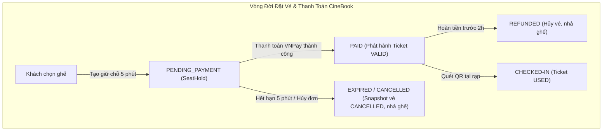

# Cẩm Nang Nghiệp Vụ & Hướng Dẫn Bảo Vệ Đồ Án Tốt Nghiệp CineBook
**CineBook Business Rules & Thesis Defense Architectural Guide**

- **Hệ thống**: Hệ thống Đặt vé và Quản lý Cụm rạp Chiếu phim CineBook
- **Đối tượng**: Tài liệu dành cho Sinh viên bảo vệ Đồ án Tốt nghiệp & Hội đồng Chấm thi
- **Ngôn ngữ**: Tiếng Việt (Thuật ngữ chuyên ngành, định danh mã nguồn và API giữ nguyên tiếng Anh)
- **Phiên bản**: 2.0 (Tháng 10/2026)

---

## MỤC LỤC

1. [Phần 1: Nguyên Tắc Thiết Kế Nghiệp Vụ CineBook](#phần-1-nguyên-tắc-thiết-kế-nghiệp-vụ-cinebook)
2. [Phần 2: Danh Sách Nghiệp Vụ & Xử Lý Ngoại Lệ của 11 Phân Hệ](#phần-2-danh-sách-nghiệp-vụ--xử-lý-ngoại-lệ-của-11-phân-hệ)
3. [Phần 3: Bộ Câu Hỏi Phản Biện Của Hội Đồng & Đáp Án Chuẩn Kiến Trúc (Q&A)](#phần-3-bộ-câu-hỏi-phản-biện-của-hội-đồng--đáp-án-chuẩn-kiến-trúc-qa)
4. [Phần 4: Bảng Tổng Kết Quyết Định Thiết Kế Nghiệp Vụ](#phần-4-bảng-tổng-kết-quyết-định-thiết-kế-nghiệp-vụ)

---

## PHẦN 1: NGUYÊN TẮC THIẾT KẾ NGHIỆP VỤ CINEBOOK

### 1.1. Tại sao không bao giờ xóa dữ liệu giao dịch? (Preservation of Transactional Data)
Trong nghiệp vụ rạp chiếu phim và thương mại điện tử thực tế, mọi hành vi phát sinh giao dịch tiền tệ, đặt chỗ, hủy vé, hoặc soát vé đều có giá trị pháp lý và giá trị kiểm toán tài chính (Financial Auditing):
- **Bảo toàn dữ liệu báo cáo doanh thu & thuế**: Nếu xóa một đơn đặt vé hoặc một suất chiếu đã có vé bán, toàn bộ báo cáo doanh thu theo ngày/tháng/năm sẽ bị lệch số liệu kế toán.
- **Bảo vệ toàn vẹn khóa ngoại (Referential Integrity)**: Các bảng `payments`, `tickets`, `booking_promotions`, `booking_foods` đều tham chiếu trực tiếp đến `bookings(id)`. Xóa vật lý (Hard Delete) sẽ gây vi phạm ràng buộc khóa ngoại hoặc tạo ra các bản ghi mồ côi (Orphan records).
- **Hỗ trợ truy vết & chăm sóc khách hàng (Customer Support & Fraud Detection)**: Khi khách hàng khiếu nại về tiền đã trừ tại ngân hàng nhưng không nhận được vé, hệ thống cần giữ lại trạng thái bản ghi `Payment`, `Booking(EXPIRED)`, và lịch sử `SeatHold` đã được lưu vết sang `Ticket(CANCELLED)` để làm bằng chứng đối soát.

### 1.2. Nguyên tắc Snapshot Bất Biến (Snapshot Immutability)
- **Snapshot giá vé (`tickets.ticket_price`)**: Giá vé tính toán tại thời điểm thanh toán được lưu cứng vào từng bản ghi vé. Dù sau này quản trị viên có điều chỉnh giá gốc suất chiếu (`basePrice`), tăng phụ thu ngày cuối tuần, hay thay đổi bảng giá khung giờ vàng, các vé đã bán trong quá khứ **tuyệt đối không bị tính lại giá**.
- **Snapshot món ăn (`booking_foods`)**: Giá bán và tên món bắp nước tại thời điểm khách đặt vé được snapshot cố định, không phụ thuộc vào việc món ăn tăng giá sau đó.
- **Snapshot khuyến mãi (`booking_promotions`)**: Số tiền chiết khấu thực tế (`discountAmount`) được snapshot tại thời điểm tạo đơn.

### 1.3. Phân định Trách nhiệm Kiến trúc Phân tầng (Layered Architecture Responsibility)
- **Controller Layer (Thin)**: Tiếp nhận HTTP Request, thực hiện Bean Validation (`@Valid`), giải mã thông tin xác thực, chuyển tiếp xuống Service, và trả về HTTP Status phù hợp. Tuyệt đối không chứa logic tính toán nghiệp vụ hay câu truy vấn CSDL.
- **Service Layer (Thick / Rich Domain Logic)**: Nắm giữ toàn bộ nghiệp vụ, ranh giới giao dịch ACID (`@Transactional`), kiểm soát bất biến dữ liệu, xử lý ngoại lệ nghiệp vụ (`AppException`), và điều phối luồng xử lý.
- **Repository Layer (Spring Data JPA)**: Tương tác với CSDL MySQL thông qua JPA Entity và JPQL/Native SQL tối ưu.
- **MySQL 8 (Single Source of Truth)**: Là chân lý duy nhất của hệ thống. Mọi quy tắc chống trùng lặp (Concurrency) và toàn vẹn đều được bảo vệ kép ở cả tầng code và tầng ràng buộc CSDL (`uk_*`, `fk_*`).

---

## PHẦN 2: DANH SÁCH NGHIỆP VỤ & XỬ LÝ NGOẠI LỆ CỦA 11 PHÂN HỆ



---

### Phân hệ 1: Quản lý Phim (Movie Management)
- **Luồng chuẩn**:
  - Phim có 4 trạng thái: `COMING_SOON` (sắp chiếu), `NOW_SHOWING` (đang chiếu), `ENDED` (kết thúc chiếu), `HIDDEN` (tạm ẩn/xóa mềm).
  - Khách hàng chỉ nhìn thấy phim ở trạng thái `COMING_SOON` và `NOW_SHOWING`.
- **Ngoại lệ & Quy tắc bảo vệ**:
  - **Chặn xóa/ẩn phim khi còn suất chiếu tương lai**: Khi gọi `DELETE /api/v1/admin/movies/{id}` hoặc `PUT /api/v1/admin/movies/{id}` với trạng thái `HIDDEN`/`ENDED`, hệ thống kiểm tra `existsByMovieIdAndStatusAndStartTimeAfter(id, SCHEDULED, now)`. Nếu còn suất chiếu tương lai, hệ thống trả về `400 Bad Request`: `"Không thể xóa hoặc ẩn phim vì vẫn còn các suất chiếu sắp tới chưa diễn ra."`.
  - **Bảo toàn dữ liệu lịch sử**: Phim đã từng chiếu và bán vé không bao giờ bị xóa cứng khỏi MySQL, đảm bảo các báo cáo thống kê doanh thu lịch sử theo phim luôn chính xác.

---

### Phân hệ 2: Quản lý Cụm Rạp (Cinema Management)
- **Luồng chuẩn**:
  - Quản trị viên quản lý danh sách rạp chiếu, địa chỉ, thành phố, giờ mở cửa (`openingTime`) và giờ đóng cửa (`closingTime`).
  - Trạng thái rạp: `ACTIVE`, `CLOSED`.
- **Ngoại lệ & Quy tắc bảo vệ**:
  - **Chặn đóng cửa/xóa rạp khi còn suất chiếu**: Nếu bất kỳ phòng chiếu nào trong cụm rạp còn suất chiếu `SCHEDULED` trong tương lai (`startTime > now`), hệ thống từ chối xóa mềm hoặc chuyển trạng thái sang `CLOSED`, trả về `400 Bad Request`: `"Không thể đóng hoặc xóa rạp chiếu vì vẫn còn các suất chiếu sắp tới chưa hoàn thành."`.

---

### Phân hệ 3: Quản lý Phòng Chiếu (Auditorium & Seat Layout Management)
- **Luồng chuẩn**:
  - Phòng chiếu thuộc về một cụm rạp. Trạng thái gồm `ACTIVE`, `MAINTENANCE` (bảo trì), `DECOMMISSIONED` (ngừng hoạt động).
  - Có các tham số vật lý: `turnaroundMinutes` (thời gian dọn phòng, mặc định 15p), `snapIntervalMinutes` (bước nhảy làm tròn giờ chiếu).
- **Ngoại lệ & Quy tắc bảo vệ**:
  - **Chặn xóa phòng chiếu**: Chỉ cho phép xóa khi phòng chiếu **chưa từng có bất kỳ suất chiếu hoặc đơn đặt vé nào** (`!existsByAuditoriumId`). Nếu đã có dữ liệu, trả về `409 Conflict`.
  - **Chặn chuyển phòng sang bảo trì**: Không cho phép chuyển sang `MAINTENANCE` hoặc `DECOMMISSIONED` nếu phòng còn suất chiếu `SCHEDULED` sắp tới.
  - **Bảo vệ sơ đồ ghế (Seat Layout Protection)**: Thao tác cấu hình lại ghế đôi (Couple) hoặc reset layout bị từ chối (`409 Conflict`) nếu phòng đã phát sinh giao dịch đặt vé, đang có người giữ chỗ, hoặc đang có lịch chiếu sắp diễn ra.

---

### Phân hệ 4: Quản lý Suất Chiếu (Showtime Lifecycle Management)
- **Luồng chuẩn**:
  - Suất chiếu thuộc một phim và một phòng chiếu. Trạng thái: `SCHEDULED`, `CANCELLED`, `FINISHED`.
  - Giờ kết thúc được tính chuẩn hóa từ thời lượng phim: `endTime = startTime + durationMinutes`.
  - Suất chiếu tự động chuyển sang `FINISHED` khi `now >= endTime` qua cron job định kỳ.
- **Ngoại lệ & Quy tắc bảo vệ 3 trường hợp xóa/hủy suất chiếu**:
  - **Case 1 (Không có đơn đặt vé nào)**: Cho phép xóa vật lý (Physical Delete) khỏi CSDL và dọn dẹp các bản ghi giữ chỗ mồ côi nếu có.
  - **Case 2 (Có đơn đặt vé nhưng CHƯA thanh toán)**: Cho phép hủy suất chiếu (`Showtime -> CANCELLED`), tự động chuyển các đơn chờ thanh toán sang `CANCELLED`, giải phóng toàn bộ `seat_holds`.
  - **Case 3 (ĐÃ CÓ VÉ THANH TOÁN THÀNH CÔNG)**: **NGHIÊM CẤM XÓA HOẶC HỦY SUẤT CHIẾU**. Trả về lỗi `400 Bad Request`: `"Không thể xóa suất chiếu vì đã có vé đã thanh toán."`.
- **Bảo vệ khi chỉnh sửa suất chiếu (`PUT`)**:
  - Nếu đã có đơn đặt vé: Cấm thay đổi phim, phòng chiếu, giờ bắt đầu hoặc giờ kết thúc.
  - Nếu suất chiếu đã `CANCELLED` hoặc `FINISHED`: Cấm chỉnh sửa (`400 Bad Request`).
- **Bộ lọc hiển thị phía khách hàng (Customer Visibility)**:
  - Khách hàng chỉ thấy các suất chiếu có trạng thái `SCHEDULED` VÀ `startTime > now`.
  - Suất chiếu đã bắt đầu, đã kết thúc, hoặc bị hủy hoàn toàn bị ẩn khỏi API công khai.

---

### Phân hệ 5: Quản lý Ghế & Giữ Chỗ Đồng Thời (Seat Concurrency & Hold)
- **Luồng chuẩn**:
  - Khách hàng giữ ghế tối đa 5 phút (`HOLD_DURATION_MINUTES = 5`).
  - Số lượng ghế tối đa mỗi đơn: 8 ghế (`MAX_SEATS_PER_BOOKING = 8`).
- **Cơ chế chống Race Condition khi 2 khách cùng chọn 1 ghế**:
  - **Tầng CSDL (Authoritative SSOT)**: Ràng buộc duy nhất `uk_seat_holds_showtime_seat` trên cặp `(showtime_id, seat_id)` trong MySQL.
  - Khi 2 khách hàng gửi yêu cầu giữ ghế đồng thời, MySQL Transaction Engine đảm bảo chỉ có 1 giao dịch INSERT thành công; giao dịch thứ 2 sẽ bắn lỗi `DataIntegrityViolationException`.
  - Backend bắt ngoại lệ này và chuyển đổi thành `409 Conflict`: `"Một hoặc nhiều ghế đã được người khác giữ chỗ hoặc phát sinh xung đột dữ liệu."`.
- **Quy tắc không để lại ghế trống đơn lẻ (No Single Orphan Seat Rule)**:
  - Khách hàng không được chọn vị trí ghế làm cô lập 1 ghế trống duy nhất có sức chứa 1 người giữa các ghế đã bán, ghế đã chọn, lối đi hoặc biên phòng chiếu.
  - Được kiểm tra đồng thời ở cả Frontend (UX cảnh báo) và Backend (Authoritative Validation).

---

### Phân hệ 6: Quản lý Đơn Đặt Vé (Booking State Machine)
- **Máy trạng thái đơn vé**:
  ```text
  PENDING_PAYMENT  ──(Thanh toán thành công)──►  PAID  ──(Hoàn tiền thành công)──►  REFUNDED
         │
         ├──(Hết hạn 5 phút)──────────────────►  EXPIRED
         └──(Khách / Admin hủy)───────────────►  CANCELLED
  ```
- **Kiểm soát hết hạn giữ chỗ hai tầng (Two-Tier Expiration)**:
  - **Tầng chủ động (Proactive Background Task)**: `BookingCleanupTask` chạy mỗi 10 giây, quét các đơn `PENDING_PAYMENT` có `holdExpiresAt <= now` theo lô 100 đơn với giao dịch riêng biệt.
  - **Tầng bị động (Lazy Expiration)**: Khi khách hàng gọi API xem chi tiết, tạo thanh toán, hoặc hủy đơn, hệ thống kiểm tra `holdExpiresAt <= now`, nếu quá hạn sẽ kích hoạt giải phóng ngay.
- **Bảo toàn lịch sử ghế đã chọn**:
  - Trước khi xóa `seat_holds`, hệ thống snapshot toàn bộ ghế khách đã giữ thành bản ghi `Ticket` với trạng thái `CANCELLED`. Nhờ đó, cả 5 trạng thái đơn hàng đều hiển thị đầy đủ danh sách ghế đã từng chọn trong lịch sử.

---

### Phân hệ 7: Quản lý Thanh Toán & Cổng VNPay (Payment & Refund)
- **Luồng chuẩn**:
  - Tích hợp VNPay Sandbox với phương thức bảo mật mã hóa HMAC-SHA512.
  - Khởi tạo thanh toán trả về `paymentUrl` kèm `vnp_TxnRef` định danh duy nhất.
- **Xử lý Webhook IPN Idempotent**:
  - Kiểm tra chữ ký `vnp_SecureHash`.
  - Đối chiếu mã Terminal `vnp_TmnCode`.
  - Đối chiếu số tiền `vnp_Amount == payment.amount * 100`.
  - **Kiểm tra Idempotent**: Nếu giao dịch không còn ở trạng thái `PENDING`, trả về ngay `{RspCode: "02", Message: "Order already confirmed"}` mà không xử lý lặp lại.
- **Xử lý tình huống Race Condition tài chính (Late IPN Callback)**:
  - Nếu khách thanh toán thành công tại ngân hàng nhưng mạng chậm khiến IPN về tới server khi đơn vé ở rạp đã quá 5 phút và đã bị `EXPIRED`:
    - `Payment` được cập nhật `SUCCESS` (ghi nhận đúng dòng tiền thực tế).
    - `Booking` giữ nguyên `EXPIRED`, **tuyệt đối không phát hành vé** để tránh nguy cơ bán trùng ghế đã bị nhả ra.
    - Hệ thống ghi log cảnh báo tài chính quan trọng để Quản trị viên tiến hành đối soát và hoàn tiền thủ công cho khách qua `POST /api/v1/admin/bookings/{id}/refund`.
- **Chính sách hoàn tiền**:
  - Khách chỉ được hoàn tiền nếu đơn ở trạng thái `PAID`, giao dịch thanh toán `SUCCESS`, **trước giờ chiếu tối thiểu 2 tiếng**, và **chưa có bất kỳ vé nào được quét vào rạp (`USED`)**.

---

### Phân hệ 8: Quản lý Vé & Soát Vé Điện Tử (Ticket & Check-In Workflow)
- **Luồng chuẩn**:
  - Một đơn hàng chỉ phát hành **duy nhất một mã QR đại diện** chứa chuỗi bí mật `checkInCode` (UUIDv4 ngẫu nhiên), phân biệt hoàn toàn với `bookingCode` công khai.
  - Nhân viên soát vé tại cửa chỉ cần quét 1 mã QR để check-in toàn bộ ghế trong đơn.
- **Bảo vệ chống quét mã đồng thời (Deadlock & Concurrency Prevention)**:
  - Thứ tự khóa bi quan toàn hệ thống: Luôn khóa bản ghi `Booking` trước (`findByIdWithLock`), sau đó mới khóa các bản ghi `Ticket`.
  - Áp dụng đồng nhất ở cả kiểm tra đơn và soát vé từng ghế để triệt tiêu hoàn toàn nguy cơ Deadlock giữa các cổng quét vé.
- **Chống quét trùng (Double-Scan Protection)**:
  - Nếu toàn bộ vé trong đơn đã chuyển sang `USED`, lần quét tiếp theo trả về `409 Conflict`.
  - Nếu có một số vé đã quét trước và còn một số vé chưa quét, hệ thống check-in các vé còn lại và báo cáo trạng thái `PARTIALLY_CHECKED_IN`.

---

### Phân hệ 9: Quản lý Người Dùng & Phân Quyền (User & RBAC)
- **Luồng chuẩn**:
  - Vai trò: `CUSTOMER`, `ADMIN`.
  - Trạng thái người dùng: `ACTIVE`, `BLOCKED`.
- **Quy tắc bảo vệ Quản trị viên (Admin Protection Invariants)**:
  - **Self-Disable Protection**: Quản trị viên không thể tự khóa tài khoản của chính mình (`BLOCKED`).
  - **Self-Demotion Protection**: Quản trị viên không thể tự tước bỏ quyền `ADMIN` của chính mình.
  - **Last Active Admin Protection**: Hệ thống cấm khóa hoặc tước quyền Quản trị viên nếu đó là Admin hoạt động cuối cùng còn lại trong hệ thống. Thao tác này được bảo vệ bằng khóa bi quan trên bảng `roles` để chống tình huống 2 Admin cùng lúc tự hạ quyền nhau.
  - **Không cho phép xóa cứng người dùng**: Người dùng có lịch sử đặt vé không bao giờ bị xóa vật lý khỏi CSDL, chỉ hỗ trợ vô hiệu hóa tài khoản (`BLOCKED`).

---

### Phân hệ 10: Quản lý Định Giá Động (Capacity-Aware Dynamic Pricing)
- **Công thức định giá chuẩn (V1)**:
  $$\text{Ticket Price} = \max\left(0, (\text{Showtime Base Price} \times \text{Seat Capacity}) + \text{Seat Modifier} + \text{Day Modifier} + \text{Time Slot Modifier}\right)$$
- **Quy tắc nhân sức chứa (Capacity Scaling)**:
  - Ghế đơn (`STANDARD`, `VIP`): `capacity = 1` $\implies$ Giá gốc suất chiếu nhân 1.
  - Ghế đôi (`COUPLE`): `capacity = 2` (phục vụ 2 người ngồi) $\implies$ Giá gốc suất chiếu nhân 2, phụ thu tiện ích không gian áp dụng cho cả khối ghế.
- **Single Source of Truth cho giá tối thiểu**:
  - `PricingService.calculateMinimumTicketPrice(Showtime)` là nguồn chân lý duy nhất tính toán mức giá thấp nhất hiển thị trên các thẻ phim ngoài trang chủ (`"Từ ... VND"`), đảm bảo khách hàng nhìn thấy đúng mức giá tối thiểu thực tế khi vào chọn ghế.

---

### Phân hệ 11: Tự Động Xếp Lịch Chiếu Đa Phim (Automatic Scheduling Engine)
- **Mục tiêu**: Tối ưu hóa việc xếp lịch chiếu cho nhiều bộ phim khác nhau trong một ngày dựa trên định mức quota mong muốn (`targetScreeningsPerDay`) và thời lượng thực tế của từng phim.
- **Khái niệm trọng tâm**:
  - `Turnaround Minutes`: Thời gian dọn dẹp phòng chiếu giữa 2 suất chiếu (vật lý, thường 10-20 phút, mặc định 15 phút).
  - `Snap Interval`: Bước nhảy chuẩn hóa mốc giờ bắt đầu đẹp (dễ nhớ cho khán giả, ví dụ: 10 phút, 15 phút).
- **Hàm chấm điểm heuristic tham lam (Deficit-Aware Scoring)**:
  $$\text{Score} = (\text{deficitRatio} \times 1000.0) + (\text{remaining} \times 10.0) - \text{consecutivePenalty} - \text{simultaneousPenalty} - \text{concentrationPenalty}$$
  - Ưu tiên cao nhất cho phim có tỷ lệ thiếu hụt quota lớn nhất.
  - Phạt nặng phim chiếu liên tiếp trong 1 phòng để tạo sự đa dạng chương trình chiếu.
  - Phạt phim chiếu trùng giờ ở các phòng khác nhau (cho phép nhưng hạn chế).
- **Quota là mục tiêu, không phải bảo đảm tuyệt đối (Target vs Guarantee)**:
  - Khi tổng thời lượng phim vượt quá khung giờ hoạt động của rạp (ví dụ: mở cửa 08:00 - đóng cửa 23:00), động cơ sẽ tự động xếp tối đa các suất khả thi và phân loại nguyên nhân thiếu hụt: `INSUFFICIENT_AUDITORIUM_CAPACITY` hoặc `MOVIE_DURATION_CONSTRAINT`.

---

## PHẦN 3: BỘ CÂU HỎI PHẢN BIỆN CỦA HỘI ĐỒNG & ĐÁP ÁN CHUẨN KIẾN TRÚC (Q&A)

### Câu 1: Làm thế nào hệ thống giải quyết bài toán Concurrency khi 2 khách hàng cùng bấm giữ một ghế tại cùng một mili-giây?
**Trả lời**:
Hệ thống giải quyết bài toán này thông qua **Cơ chế Bảo vệ Kép (Defense-in-Depth)**:
1. **Tầng ứng dụng (Application Level)**: Trước khi lưu, hệ thống kiểm tra các bản ghi giữ chỗ đang còn hạn (`findActiveHoldsByShowtimeAndSeatIds`) và các vé đã thanh toán (`findTicketsByShowtimeAndSeatIdsAndStatuses`).
2. **Tầng cơ sở dữ liệu (Database Constraint Level - SSOT)**: CineBook thiết kế ràng buộc khóa duy nhất `uk_seat_holds_showtime_seat` trên cặp `(showtime_id, seat_id)` trong bảng `seat_holds`.
   - Do MySQL InnoDB quản lý khóa ghi theo hàng (Row-level Lock), khi 2 transaction đồng thời thực thi lệnh `INSERT`, một giao dịch sẽ thành công trước và giao dịch còn lại lập tức bị MySQL chặn lại vì vi phạm khóa duy nhất (`DataIntegrityViolationException`).
   - Tầng Service bắt ngoại lệ này và chuyển thành lỗi `409 Conflict` thân thiện cho người dùng.
3. Nhờ cơ chế này, hệ thống **không cần dùng đến Redis Lock** hay hạ tầng phân tán phức tạp, vẫn đảm bảo 100% không bao giờ xảy ra tình trạng bán trùng ghế (Double-Booking).

---

### Câu 2: Tại sao suất chiếu đã có vé đã bán không cho phép xóa, và khi cập nhật không cho đổi phim, phòng chiếu, hay giờ chiếu?
**Trả lời**:
Đây là quy tắc bất biến trong nghiệp vụ quản lý rạp chiếu thực tế:
- **Bảo vệ quyền lợi khách hàng & pháp lý giao dịch**: Khách hàng đã thanh toán tiền cho một suất chiếu cụ thể (đúng phim, đúng phòng, đúng giờ). Nếu hệ thống cho phép đổi phim hoặc đổi giờ chiếu mà không có quy trình hủy vé/hoàn tiền minh bạch, khách hàng sẽ cầm vé đến rạp nhưng xem một bộ phim khác hoặc vào rạp sai giờ.
- **Bảo vệ tính toàn vẹn cơ sở dữ liệu**: Bảng `tickets` và `bookings` lưu trữ `showtime_id`. Nếu xóa suất chiếu, các bản ghi vé sẽ bị mất liên kết đến suất chiếu hoặc vi phạm khóa ngoại `FKbookings564687`.
- **Giải pháp chuẩn của CineBook**:
  - Không có vé: Cho phép xóa vật lý.
  - Có đơn nhưng chưa thanh toán: Cho phép hủy suất chiếu (`Showtime -> CANCELLED`), tự động hủy các đơn chờ thanh toán và nhả ghế.
  - Đã có vé thanh toán: Tuyệt đối cấm xóa. Quản trị viên chỉ có thể liên hệ khách hàng để xử lý hoàn tiền qua chức năng Refund trước khi áp dụng bất kỳ thay đổi nào.

---

### Câu 3: Khách hàng thanh toán tại cổng VNPay thành công, nhưng do nghẽn mạng nên webhook IPN trả về chậm sau khi đơn giữ chỗ ở rạp đã quá 5 phút và bị hủy (Expired). Hệ thống xử lý trường hợp này như thế nào?
**Trả lời**:
Đây là bài toán kinh điển về **Bất đồng bộ Tài chính (Financial Asynchrony & Race Condition)** giữa Cổng thanh toán và Rạp chiếu:
1. Khi đơn vé hết hạn 5 phút, cơ chế `BookingCleanupTask` đã giải phóng ghế trong `seat_holds` về trạng thái khả dụng để khách khác có thể mua.
2. Khi IPN từ VNPay về muộn với mã `"00"` (thành công):
   - Bản ghi `Payment` được cập nhật thành `SUCCESS` vì tiền của khách đã thực sự được trừ tại cổng thanh toán.
   - Bản ghi `Booking` **giữ nguyên trạng thái `EXPIRED`**, và hệ thống **tuyệt đối không phát hành vé**. Lý do: nếu tự động phát hành vé, rạp có thể bán trùng ghế cho người khác đã mua trong khoảng thời gian ghế vừa được giải phóng.
   - Hệ thống ghi log kiểm toán tài chính nghiêm trọng: `[NGOẠI LỆ TÀI CHÍNH QUAN TRỌNG]`.
3. Quản trị viên sẽ nhìn thấy đơn hàng này trong danh sách đối soát thanh toán và thực hiện hoàn tiền tự động về tài khoản khách hàng thông qua endpoint `POST /api/v1/admin/bookings/{id}/refund`. Nhờ đó, rạp không bao giờ bị bán trùng ghế và quyền lợi tài chính của khách hàng được bảo vệ trọn vẹn.

---

### Câu 4: Giá vé thay đổi (ví dụ: Admin tăng phụ thu ngày cuối tuần từ 10.000 lên 20.000 VND) có làm thay đổi số tiền của các vé khách đã mua trong quá khứ không?
**Trả lời**:
Hoàn toàn **KHÔNG**.
- Hệ thống CineBook áp dụng nghiêm ngặt nguyên tắc **Snapshot Bất Biến (Snapshot Immutability)**:
  - Khi khách hàng thanh toán thành công, giá của từng chiếc vé được tính toán qua `PricingService` và lưu cứng vào cột `tickets.ticket_price`.
  - Tổng tiền đơn hàng được lưu cứng vào cột `bookings.total_amount`.
  - Bảng `day_pricing_rules` và `time_slot_pricing_rules` chỉ đóng vai trò là các tham số cấu hình phục vụ việc tính giá cho các giao dịch mới phát sinh.
  - Các truy vấn báo cáo tài chính, doanh thu, hay xử lý hoàn tiền đều đọc trực tiếp từ `tickets.ticket_price` và `bookings.total_amount`, hoàn toàn độc lập với các thay đổi cấu hình giá hiện tại.

---

### Câu 5: Tại sao CineBook lựa chọn kiến trúc Monolith thay vì Microservices cho đồ án này?
**Trả lời**:
Lựa chọn kiến trúc Monolith là một quyết định kỹ thuật có chủ đích dựa trên phân tích chi phí - lợi ích (Trade-off Analysis):
1. **Tính nhất quán giao dịch ACID**: Nghiệp vụ rạp chiếu phim (giữ ghế, khóa thanh toán, sinh vé, dọn dẹp) đòi hỏi tính nhất quán dữ liệu tức thời (Immediate Consistency). Kiến trúc Monolith cho phép sử dụng transaction cục bộ của MySQL (`@Transactional`) với độ tin cậy tuyệt đối, tránh được sự phức tạp và rủi ro lỗi của các giao dịch phân tán (2PC hoặc Saga Pattern).
2. **Chi phí vận hành và tài nguyên**: Microservices yêu cầu hạ tầng phức tạp như Service Discovery (Eureka/Consul), API Gateway, Distributed Tracing, và Message Broker (Kafka/RabbitMQ). Trong phạm vi đồ án tốt nghiệp với thời gian triển khai 1 tháng, Monolith giúp đội ngũ tập trung tối đa vào việc hoàn thiện logic nghiệp vụ thực tế, tối ưu hóa hiệu năng câu truy vấn và giao diện người dùng.
3. **Hiệu năng cao**: Monolith loại bỏ hoàn toàn độ trễ mạng (Network Latency) do các lời gọi RPC/REST nội bộ giữa các microservice gây ra.

---

### Câu 6: Làm thế nào thuật toán xếp lịch chiếu tự động giải quyết tình huống phòng chiếu không đủ thời gian để chiếu hết toàn bộ số suất mong muốn của các phim?
**Trả lời**:
Trong thực tế rạp chiếu phim, không phải lúc nào mục tiêu kinh doanh cũng vừa vặn với dung lượng phòng chiếu vật lý. Thuật toán của CineBook được thiết kế với triết lý: **Quota là mục tiêu (Target), không phải bảo đảm tuyệt đối (Guarantee)**:
1. **Nguyên tắc Khả thi trước tiên (Feasibility-First)**: Động cơ chỉ lên lịch cho một suất chiếu nếu suất chiếu đó thỏa mãn: không trùng lấn, đảm bảo thời gian dọn phòng (`turnaroundMinutes`), và hoàn thành trước giờ đóng cửa rạp (`closingTime`).
2. **Phân bổ theo mức độ thâm hụt (Deficit-Aware Scoring)**: Bộ chấm điểm heuristic liên tục tính toán tỷ lệ thiếu hụt quota $\text{deficitRatio} = (\text{target} - \text{scheduled}) / \text{target}$. Phim nào đang bị thiếu hụt nhiều nhất sẽ được ưu tiên xếp vào các khung giờ vàng trước.
3. **Phân loại nguyên nhân sức chứa (Capacity Shortfall Classification)**: Khi một phòng không thể nhét thêm phim nào trước giờ đóng cửa, hệ thống dừng phòng đó lại và báo cáo rõ ràng:
   - `INSUFFICIENT_AUDITORIUM_CAPACITY`: Thời gian mở cửa của rạp không đủ để chiếu toàn bộ số phim yêu cầu.
   - `MOVIE_DURATION_CONSTRAINT`: Thời lượng của phim dài hơn khoảng trống thời gian còn lại trước giờ đóng cửa.
   Nhờ cơ chế này, hệ thống không bao giờ bị treo vòng lặp vô tận và cung cấp thông tin rõ ràng cho Quản trị viên để điều chỉnh lại kế hoạch chiếu.

---

### Câu 7: Quét mã QR tại cổng soát vé: Khách mua 5 vé thì hệ thống sinh ra 5 mã QR hay 1 mã QR? Làm sao chống nhân viên hoặc khách quét trùng?
**Trả lời**:
CineBook áp dụng mô hình **One Booking, One E-Ticket QR (Một đơn hàng, Một mã QR đại diện)**:
1. **Thiết kế QR**: Hệ thống sinh một mã QR duy nhất chứa chuỗi bí mật `checkInCode` (UUIDv4) ở cấp độ `Booking`. Nhân viên chỉ cần quét 1 lần duy nhất là toàn bộ 5 ghế trong đơn đều được xác nhận vào rạp, giúp giảm thời gian xếp hàng tại cổng soát vé.
2. **Bảo mật mã soát vé**: Mã hiển thị cho khách hàng (`bookingCode`, ví dụ `CB-20261002-ABCXYZ`) hoàn toàn khác với `checkInCode`. API soát vé chỉ chấp nhận `checkInCode`, ngăn chặn hành vi đoán mã đơn để check-in trái phép.
3. **Chống quét trùng**:
   - Khi quét, hệ thống áp dụng khóa bi quan trên `Booking` và kiểm tra trạng thái vé.
   - Nếu tất cả các vé đã là `USED`, hệ thống trả về `409 Conflict: "Đơn đặt vé đã được soát vé toàn bộ."`.
   - Nếu có người vào trước một vài ghế và người vào sau, hệ thống chuyển các vé còn lại sang `USED` và thông báo trạng thái `PARTIALLY_CHECKED_IN`.

---

### Câu 8: Tại sao hệ thống không sử dụng Redis Distributed Lock để giữ ghế mà lại sử dụng ràng buộc duy nhất của MySQL?
**Trả lời**:
Đây là quyết định kiến trúc dựa trên nguyên tắc **MySQL là Nguồn Chân Lý Duy Nhất (Single Source of Truth)**:
1. **Tính toàn vẹn và độ tin cậy (Durability)**: Redis là bộ nhớ in-memory. Nếu Redis gặp sự cố rớt mạng, tràn RAM, hoặc restart, các khóa giữ chỗ có thể bị mất, dẫn đến tình trạng hai khách hàng cùng được xác nhận mua một ghế trên MySQL.
2. **Loại bỏ sự không nhất quán giữa 2 kho dữ liệu (Split-Brain / Dual-Write)**: Nếu sử dụng Redis Lock, hệ thống phải duy trì trạng thái ghế ở cả Redis và MySQL. Khi xảy ra lỗi mạng giữa Spring Boot và Redis, việc đồng bộ giữa 2 hệ thống trở nên cực kỳ phức tạp.
3. **Tận dụng sức mạnh của RDBMS Engine**: Ràng buộc duy nhất `uk_seat_holds_showtime_seat` trên MySQL là cơ chế atomic, tuân thủ ACID 100%, được bảo vệ bởi InnoDB Engine và Write-Ahead Logging (WAL). Do đó, việc dùng DB Constraint vừa đơn giản hóa kiến trúc, vừa đạt độ tin cậy cao nhất cho hệ thống rạp chiếu phim.

---

## PHẦN 4: BẢNG TỔNG KẾT QUYẾT ĐỊNH THIẾT KẾ NGHIỆP VỤ

| Quyết định thiết kế | Phương án lựa chọn | Phương án bị từ chối | Lý do kỹ thuật & Nghiệp vụ |
|---|---|---|---|
| **Kiến trúc hệ thống** | Monolithic Layered Architecture | Microservices, Distributed Transactions | Đảm bảo tính toàn vẹn giao dịch ACID cục bộ, loại bỏ độ trễ mạng và chi phí vận hành phân tán. |
| **Cơ chế chống Double-Booking** | Database Unique Constraint (`uk_seat_holds_showtime_seat`) | Redis Distributed Lock | MySQL là Single Source of Truth; loại bỏ rủi ro mất khóa khi cache gặp sự cố. |
| **Bảo toàn dữ liệu lịch sử** | Soft Delete (`deletedAt`) & Status Transitions | Hard Delete (`DELETE CASCADE`) | Bảo toàn số liệu kế toán, kiểm toán tài chính và toàn vẹn khóa ngoại `FK`. |
| **Giá vé và bắp nước** | Snapshot bất biến tại thời điểm thanh toán | Tính toán động theo thời gian thực | Mọi thay đổi bảng giá sau này không được làm thay đổi số tiền của đơn hàng đã mua trong quá khứ. |
| **Mã QR soát vé** | 1 mã QR đại diện cho cả đơn vé (`checkInCode`) | Mỗi ghế 1 mã QR riêng | Tối ưu hóa trải nghiệm khách hàng và tốc độ soát vé tại cửa ra vào rạp. |
| **Xếp lịch chiếu đa phim** | Heuristic tham lam có tính tỷ lệ thiếu hụt quota | Stagger Interval cố định phòng | Cho phép các phòng chiếu hoạt động độc lập, hỗ trợ chiếu song song nhiều phòng cho phim bom tấn. |
| **Xử lý trễ Webhook IPN** | `Payment -> SUCCESS`, `Booking -> EXPIRED`, hoàn tiền thủ công | Tự động phát hành vé muộn | Tránh nguy cơ bán trùng ghế đã bị nhả ra sau khi đơn hết hạn giữ chỗ 5 phút. |
| **Quyền Quản trị viên** | Khóa bi quan Role 'ADMIN', chặn tự khóa/hạ quyền | Cho phép xóa hoặc hạ quyền tự do | Bảo vệ hệ thống không bao giờ bị rơi vào tình trạng mất Quản trị viên hoạt động cuối cùng. |
