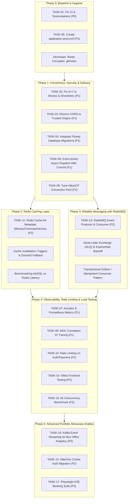

# CineBook Post-Graduation Technical Audit & Upgrade Roadmap

> **Document Type**: Technical Audit, Architectural Evolution Plan & Prioritized Portfolio Roadmap  
> **Target Version**: CineBook 2.0 (High-Performance Java Backend Portfolio Project)  
> **Original Baseline**: Monolithic Graduation Project (Spring Boot 4.0.8, Java 21, MySQL 8, Vue 3, Vite, Tailwind CSS)  
> **Audit Date**: 2026-10-16  
> **Author**: Senior Software Architect & Lead Backend Reviewer  

---

## 1. Executive Summary

CineBook was successfully delivered as a full-featured, monolithic movie ticketing and cinema management graduation project. It features complete business capabilities: movie cataloging with TMDB server-side sync, multi-cinema auditorium and seat layout management, showtime collision-free scheduling, 5-minute atomic seat holds with adjacency validation, VNPay Sandbox payment gateway integration with HMAC-SHA512 cryptographic verification, electronic QR tickets, F&B concessions, in-app notifications, and business reporting.

The project currently maintains **787 backend tests with 100% pass rate** (0 failures, 0 errors, 1 intentionally disabled external network inspection test) and **zero TypeScript compilation errors** across the Vue 3 Single Page Application.

However, as CineBook transitions from a graduation project to a **tier-1 Java Backend portfolio project** designed to demonstrate mid-to-senior software engineering capabilities, critical technical debts, scalability ceilings, and architectural limitations must be systematically addressed:
1. **Critical CI/CD & Delivery Fragility**: The integration test suite is tightly coupled to a locally pre-configured MySQL instance on `localhost:3306`, causing GitHub Actions CI to break in clean runner environments due to lack of Testcontainers or database service containers.
2. **Database & ORM Bottlenecks**: Severe N+1 query patterns exist on core public read paths (e.g., `MovieMapper.extractGenres` triggers 20–40 secondary SQL queries per catalog page due to lazy-loaded `@OneToMany` relationships without `@EntityGraph`). Database connection pool (HikariCP) is completely unconfigured.
3. **Unreliable Asynchronous Processing**: Background emails (booking confirmation, refund, verification) are dispatched via an unmanaged, in-memory `CompletableFuture.runAsync` using the global `ForkJoinPool`, losing in-flight emails upon JVM crash/restart with zero retries, no Dead-Letter Queue (DLQ), and execution prior to transaction commit.
4. **Security & Perimeter Hygiene**: CORS is configured with wildcard origin reflection while permitting credentials; sensitive public endpoints lack rate-limiting and brute-force protection; JWT tokens reside in browser `localStorage`.
5. **Observability Void**: The application has zero operational observability (no Spring Boot Actuator, no Prometheus metrics, no MDC correlation IDs, and no automated load tests).

This roadmap establishes a **pragmatic, 5-phase engineering progression** that introduces **Redis caching** and **RabbitMQ messaging** strictly where architecturally justified within the monolith, establishes comprehensive observability and reproducible testing, while strictly safeguarding the single source of truth in MySQL.

---

## 2. Verified Repository Baseline & Environment Limitations

### 2.1 Git Repository & Working Tree State
- **HEAD Commit**: `e15c4984129cbcf288adac82f70e1ce1d0179df2` (*"feat: complete system-wide business and UX enhancements"*).
- **Environment Anomaly (Git Index)**: The file `.git/index` was found to be corrupted (0 bytes, timestamp `2026-09-11 17:56:27`), resulting in `fatal: .git/index: index file smaller than expected` when executing standard `git status` or `git diff`.
  - *Root Cause Analysis*: A sudden termination or power cycle during a Git operation left a truncated index file.
  - *Remediation Protocol (For Developer)*: Safe non-destructive index rebuild: `rm .git/index` followed by `git reset` (or `git read-tree HEAD`). The working tree source code is completely intact. Per AGENTS.md rules, this action is documented for developer execution rather than executed autonomously.

### 2.2 Technology Stack & Dependency Baseline
| Layer / Tool | Configured Version | Notes & Status |
|---|---|---|
| **Java Platform** | 21 (LTS) | Modern virtual threads capable, record patterns, pattern matching |
| **Spring Boot** | 4.0.8 (`spring-boot-starter-parent`) | Spring Framework 7 / 6 baseline, Jakarta EE 11 |
| **Persistence** | Spring Data JPA / Hibernate 6.x | `open-in-view: false`, `ddl-auto: validate` |
| **Database** | MySQL 8.0.42 (InnoDB) | Default schema: `cinebook`, charset: UTF-8, timezone: `Asia/Ho_Chi_Minh` |
| **Security** | Spring Security + JJWT 0.12.6 | Dual-token: 15-min Access Token, 7-day SHA-256 hashed Refresh Token |
| **Build System** | Apache Maven 3.9+ via `mvnw` | Wrapper present; compiler plugin configured for Lombok processor |
| **Frontend Framework** | Vue 3.5.13 (Composition API) | `<script setup lang="ts">`, Pinia 3.0.1, Vue Router 4.5.0 |
| **Frontend Tooling** | Vite 6.1.0, TypeScript 5.7.3, Tailwind 3.4 | `vue-tsc --noEmit` verified 0 errors |
| **Payment Gateway** | VNPay Sandbox 2.1.0 | HMAC-SHA512 signature, IPN webhook, Return URL redirect |

### 2.3 Verified Test Baseline
The Maven test execution (`.\mvnw.cmd test`) was run and verified:
- **Total Tests Run**: **787 tests**
- **Failures**: **0**
- **Errors**: **0**
- **Skipped**: **1** (`VnPayUrlInspectionTest.inspectVariations` — marked `@Disabled` because it attempts live outbound HTTP sockets to `sandbox.vnpayment.vn`, which is subject to external network routing loops and outages).
- **Frontend Quality Gate**: `npm run typecheck` $\rightarrow$ **PASS** (0 errors). `npm run build` $\rightarrow$ **PASS** (production bundle generated in 5.23s).

### 2.4 Stale Documentation & Environmental Divergence
- **Outdated Test Count**: `docs/documentation-map.md` states *"Backend 644/646 Tests PASS (2 pre-existing local integration DB data mismatches in AuditoriumNormalization preserved)"*. In reality, the codebase now contains 787 tests with 0 failures. The 2 pre-existing failures were completely resolved.
- **Unregistered Migrations**: `docs/documentation-map.md` lists migrations `V1_1, V1_2, V1_3`. The physical filesystem contains `V1_4__add_movie_manual_overrides.sql` and `V1_5__add_reporting_performance_indexes.sql` in `src/main/resources/db/migration/`.
- **Missing Production Profile**: `docker-compose.yml` specifies `SPRING_PROFILES_ACTIVE: prod`, yet `src/main/resources/application-prod.yml` does not exist in the codebase.
- **Missing Migration Tool**: Flyway scripts exist under `src/main/resources/db/migration/`, but `flyway-core` and `flyway-mysql` are not declared in `pom.xml`.

---

## 3. Comprehensive Audit Findings & Evidence

Findings are classified into:
- **[Confirmed Defect]**: Verifiable code bug or architectural violation in the current codebase.
- **[Probable Risk]**: Concurrency, security, or data integrity hazard under specific runtime conditions.
- **[Missing Test]**: Critical business flow lacking automated test coverage.
- **[Performance Hypothesis]**: High-likelihood latency or throughput bottleneck identified through code analysis.
- **[Optional Enhancement]**: Valuable addition for enterprise readiness and portfolio strength.

Severity ratings: **P0 (Critical)**, **P1 (High)**, **P2 (Medium)**, **P3 (Low / Polish)**.

---

### Workstream A: Repository & Baseline Quality

#### [Finding A-01] [Confirmed Defect] [P0] CI Pipeline Failure in Isolated Runner Environments
- **Evidence**: `.github/workflows/ci.yml` (lines 35-42) runs `./mvnw clean test -B` with `SPRING_PROFILES_ACTIVE: test`. In `src/test/resources/application.yml` (lines 5-9), the datasource points to `jdbc:mysql://localhost:3306/cinebook` with `username: root, password: ""` and `ddl-auto: validate`. The GitHub Actions workflow does NOT spin up a MySQL service container.
- **Impact**: Any commit pushed to GitHub will fail CI on the `backend-test` job because no MySQL daemon is running on the GitHub runner. Tests only pass locally because the developer has a personal MySQL daemon active on port 3306.
- **Remediation**: Introduce Testcontainers for MySQL in integration tests or configure a GitHub Actions `services.mysql` block in `ci.yml`.

#### [Finding A-02] [Confirmed Defect] [P1] Missing `application-prod.yml` in Docker Deployment
- **Evidence**: `docker-compose.yml` (line 38) sets `SPRING_PROFILES_ACTIVE: prod`. `src/main/resources/` only contains `application.yml` and `application-local.yml`.
- **Impact**: Running `docker compose up` forces Spring Boot to boot with an unconfigured `prod` profile, falling back to base `application.yml` where datasource credentials default to root with empty password and placeholders.
- **Remediation**: Create a hardened `application-prod.yml` with strict environment variable bindings and startup validation.

#### [Finding A-03] [Confirmed Defect] [P1] Inactive Database Migration Framework
- **Evidence**: `src/main/resources/db/migration/` contains 5 SQL scripts (`V1_1` through `V1_5`), but `pom.xml` contains neither `org.flywaydb:flyway-core` nor `org.liquibase:liquibase-core`.
- **Impact**: Schema evolution is strictly manual. When new developers clone the repository or when the application is deployed via Docker, schema alterations must be hand-applied via MySQL CLI. If manual steps are forgotten, `hibernate.ddl-auto: validate` halts application startup.
- **Remediation**: Integrate Flyway Spring Boot Starter to automate execution of versioned migration scripts upon startup.

---

### Workstream B: Booking, Seat Holds, Payments & Financial Correctness

#### [Finding B-01] [Confirmed Defect] [P1] In-Memory Unmanaged Asynchronous Email Dispatch
- **Evidence**: In `EmailServiceImpl.java` (lines 73-80, 120-124, 213-220), all emails are dispatched using `CompletableFuture.runAsync(() -> mailSender.send(message))`.
- **Impact**:
  1. The tasks run in the shared Java `ForkJoinPool.commonPool()`, which is unmanaged and can be starved by CPU-intensive tasks.
  2. If the application crashes, restarts, or is redeployed immediately after a booking is confirmed, all in-flight email tasks in memory are permanently lost.
  3. If the remote SMTP server experiences a temporary socket timeout or rate limit, the exception is merely caught and logged (`log.error(...)`). There is no retry mechanism, no exponential backoff, and no dead-letter queue.
- **Remediation**: Transition email and alert notifications to a reliable message broker (RabbitMQ) backed by transactional event publishing.

#### [Finding B-02] [Probable Risk] [P1] Premature Email Dispatch Within Active Transaction
- **Evidence**: In `BookingServiceImpl.java` (lines 973-982 in `confirmPaidBooking`), `emailService.sendBookingConfirmationEmail` is invoked *inside* the `@Transactional(rollbackFor = Exception.class)` method before the method returns and before the database transaction actually commits.
- **Impact**: If a downstream line throws an exception, or if the database commit fails (e.g., connection lost during commit, serialization error), the email containing the QR ticket code will have already been dispatched asynchronously to the customer, even though the booking failed to transition to `PAID` in the database.
- **Remediation**: Use Spring's `@TransactionalEventListener(phase = TransactionPhase.AFTER_COMMIT)` or an Outbox Pattern to ensure messages/emails are only published after successful transaction commit.

#### [Finding B-03] [Performance Hypothesis] [P2] Synchronous In-App Notification Insertion in Payment Flow
- **Evidence**: In `BookingServiceImpl.confirmPaidBooking` (lines 986-1004), `notificationService.createNotification` is called twice consecutively within the main transactional thread to insert notifications into the `user_notifications` table.
- **Impact**: Increases database transaction hold time and latency for the critical payment confirmation path.
- **Remediation**: Decouple notification creation using asynchronous domain event listeners or message consumer.

#### [Finding B-04] [Verified Good Practice] [Audited] Concurrency & Double-Booking Protection
- **Evidence**: `BookingServiceImpl.createBooking` (lines 376-382, 526-540) verifies:
  1. Purges expired seat holds for candidate seats.
  2. Checks active holds in `seat_holds` where `expires_at > now()`.
  3. Checks sold tickets in `tickets` where status in `(VALID, USED)`.
  4. Inserts into `seat_holds` table, which is protected by a composite unique constraint `uk_seat_holds_showtime_seat (showtime_id, seat_id)`.
  5. Catches `DataIntegrityViolationException` and translates to `ConflictException` with transaction rollback.
- **Verdict**: Double-booking is strictly prevented at the database constraint level. Concurrency protection is sound.

#### [Finding B-05] [Verified Good Practice] [Audited] Financial Idempotency & State Machine
- **Evidence**: In `PaymentServiceImpl.processIpn` (lines 288-293) and `processReturn` (lines 393-412), if `payment.getPaymentStatus() != PaymentStatus.PENDING`, the service immediately short-circuits:
  ```java
  if (payment.getPaymentStatus() != PaymentStatus.PENDING) {
      log.info("Giao dịch VNPay IPN {} đã được xử lý trước đó với trạng thái: {}", paymentCode, payment.getPaymentStatus());
      return new IpnResponse("02", "Order already confirmed");
  }
  ```
- **Verdict**: Duplicate IPN callbacks from VNPay or simultaneous Return URL redirects cannot double-confirm or double-issue tickets.

---

### Workstream C: Database and ORM Performance

#### [Finding C-01] [Confirmed Defect] [P1] N+1 Query Cascade in Movie Cataloging
- **Evidence**: In `Movie.java` (lines 97-101), `movieGenres` is mapped as `@OneToMany(mappedBy = "movie", cascade = CascadeType.ALL, orphanRemoval = true)` with default `FetchType.LAZY`. In `MovieMapper.java` (lines 73-83), `extractGenres(Movie movie)` iterates over `movie.getMovieGenres()` and calls `mg.getGenre()`.
- **Trace**:
  1. `GET /api/v1/movies` triggers `movieRepository.findByStatus(status, pageable)`. (1 SQL query returning 20 movies).
  2. For each movie, the mapper evaluates `movie.getMovieGenres()`, triggering `SELECT * FROM movie_genres WHERE movie_id = ?` (20 queries).
  3. For each `MovieGenre`, `getGenre()` triggers `SELECT * FROM genres WHERE id = ?` (up to 20 queries).
  4. **Total Queries**: 1 + 20 + 20 = **41 database queries for a single page of 20 movies**.
- **Remediation**: Apply `@EntityGraph(attributePaths = {"movieGenres.genre"})` on `MovieRepository` methods or write an explicit `JOIN FETCH` JPQL query.

#### [Finding C-02] [Confirmed Defect] [P1] N+1 Query Cascade in Paginated Showtime Queries
- **Evidence**: In `ShowtimeRepository.java` (lines 33-40), derived queries `findByMovieId`, `findByAuditoriumId`, `findByStatus`, and `findByMovieIdAndStatus` return `Page<Showtime>`.
- **Trace**: When mapped to `ShowtimeResponse`, each showtime accesses `s.getMovie()` and `s.getAuditorium().getCinema()`. Because these are lazy relationships, Hibernate executes secondary queries for every showtime on the page.
- **Remediation**: Annotate these methods with `@EntityGraph(attributePaths = {"movie", "auditorium.cinema"})`.

#### [Finding C-03] [Performance Hypothesis] [P2] Unconfigured Connection Pool (HikariCP)
- **Evidence**: `application.yml` contains no `spring.datasource.hikari.*` configuration.
- **Impact**: HikariCP defaults to `maximum-pool-size: 10`, `minimum-idle: 10`, and `connection-timeout: 30000ms`.
  The application runs three continuous scheduled tasks:
  - `BookingCleanupTask`: runs every 10,000ms.
  - `ShowtimeCleanupTask`: runs every 300,000ms.
  - `MovieLifecycleTask`: runs every 900,000ms.
  Under concurrent user traffic (e.g., 20+ concurrent requests), thread starvation on the database connection pool will cause HTTP request queuing and high p99 latency spikes.
- **Remediation**: Configure explicit HikariCP pool properties: `maximum-pool-size: 25`, `minimum-idle: 10`, `connection-timeout: 5000`, `leak-detection-threshold: 2000`.

---

### Workstream D: Security & Perimeter Hygiene

#### [Finding D-01] [Confirmed Defect] [P1] Insecure Wildcard CORS Configuration with Credentials
- **Evidence**: In `SecurityConfig.java` (lines 141-152):
  ```java
  CorsConfiguration configuration = new CorsConfiguration();
  configuration.setAllowedOriginPatterns(List.of("*"));
  configuration.setAllowedMethods(List.of("GET", "POST", "PUT", "PATCH", "DELETE", "OPTIONS"));
  configuration.setAllowedHeaders(List.of("*"));
  configuration.setAllowCredentials(true);
  ```
- **Impact**: Setting `allowedOriginPatterns("*")` in combination with `setAllowCredentials(true)` allows arbitrary third-party websites to make credentialed cross-origin requests if an attacker tricks an authenticated user into visiting a malicious site.
- **Remediation**: Restrict `allowedOrigins` to explicitly configured domain names (e.g., `${cinebook.frontend-url}`).

#### [Finding D-02] [Probable Risk] [P1] Absence of Rate Limiting & Abuse Prevention
- **Evidence**: Public endpoints `/api/v1/auth/login`, `/api/v1/auth/register`, `/api/v1/auth/password-reset/**`, and `/api/v1/bookings/{bookingId}/payments` have no rate limiting filters or interceptors.
- **Impact**: Vulnerable to brute-force credential stuffing, automated account spam, and rapid seat reservation denial-of-service.
- **Remediation**: Implement IP- and user-based token bucket rate limiting (e.g., via Bucket4j or Redis-backed rate limiting).

#### [Finding D-03] [Probable Risk] [P2] Token Storage in Browser LocalStorage
- **Evidence**: In `frontend/src/services/api.ts` (lines 52, 95, 112-113), both `cinebook_access_token` and `cinebook_refresh_token` are read from and written to `localStorage`.
- **Impact**: Any cross-site scripting (XSS) vulnerability in any frontend dependency could expose the long-lived refresh token (7-day validity).
- **Remediation**: Migrate the Refresh Token to an `HttpOnly`, `SameSite=Strict`, `Secure` cookie, retaining only the short-lived 15-minute Access Token in memory.

---

### Workstream E: Frontend and Product Quality

#### [Finding E-01] [Missing Test] [P1] Total Lack of Automated Frontend Testing
- **Evidence**: `frontend/package.json` contains no unit or E2E test runners (no Vitest, `@vue/test-utils`, Cypress, or Playwright).
- **Impact**: Frontend regression safety rests entirely on TypeScript compile-time type-checking. UI state transitions (e.g., hold timer countdown expiry, seat adjacency warnings, VNPay redirect handling, discount code calculations) are not covered by automated regression tests.
- **Remediation**: Introduce Vitest for component unit testing and Playwright for critical booking/payment smoke tests.

#### [Finding E-02] [Verified Good Practice] [Audited] Silent Token Refresh Concurrency Control
- **Evidence**: `frontend/src/services/api.ts` (lines 31-47, 79-90) implements a `failedQueue` with `isRefreshing` boolean latch. When multiple HTTP requests receive 401 simultaneously, only a single `/api/v1/auth/refresh` call is dispatched; remaining requests wait and replay upon resolution.
- **Verdict**: Avoids refresh token race conditions and premature logout.

---

### Workstream F: Testing and Delivery

#### [Finding F-01] [Confirmed Defect] [P1] Inability to Run Integration Tests Without External MySQL
- **Evidence**: `src/test/resources/application.yml` configures an active MySQL JDBC URL. Tests annotated with `@SpringBootTest` fail immediately if port 3306 is not listening with a valid `cinebook` database.
- **Impact**: Violates self-contained test principles. Developers on macOS/Linux or CI/CD pipelines cannot run `./mvnw test` without manually provisioning and maintaining a local MySQL database.
- **Remediation**: Introduce Testcontainers with Spring Boot 3.1+ `@ServiceConnection` for MySQL test execution.

---

### Workstream G: Redis Evaluation

#### [Finding G-01] [Performance Hypothesis] [P2] Cacheable High-Read Domain Metadata
- **Evidence**: Cinema listings, genres, and active movie catalogs are requested on every customer page load but change infrequently.
- **Evaluation**: Caching candidate analysis demonstrates genuine value for `GET /api/v1/movies/now-showing`, `GET /api/v1/movies/coming-soon`, `GET /api/v1/genres`, and `GET /api/v1/cinemas`.
- **Hard Architectural Constraint**: Redis MUST NOT be authoritative for seat reservations or payment state. MySQL InnoDB remains the sole source of truth.

---

### Workstream H: RabbitMQ Evaluation

#### [Finding H-01] [Confirmed Defect / Architectural Justification] [P1] Decoupled Asynchronous Transactional Messaging
- **Evidence**: Documented in Findings B-01 and B-02. Asynchronous email and notification processing is currently bound to unmanaged threads inside active transaction boundaries.
- **Evaluation**: RabbitMQ is the optimal message broker for task-based asynchronous processing (retries, DLQ, backoff).

---

### Workstream I: Kafka Evaluation

#### [Finding I-01] [Architecture Assessment] [P3] Kafka Overkill for Core Operations
- **Evidence**: CineBook's domain operations are transactional and low-to-medium throughput (tens of bookings per minute). Task queues (emails, alerts) require per-message acknowledgment, retry backoff, and dead-lettering, which RabbitMQ natively provides. Kafka's streaming append-log model introduces unnecessary operational overhead (ZooKeeper/KRaft, partition rebalancing, manual offset management) without justifiable benefits.
- **Verdict**: Defer Kafka to an optional Phase 5 portfolio demonstration specifically for real-time analytics stream processing.

---

### Workstream J: Observability and Performance Engineering

#### [Finding J-01] [Missing Test / Observability] [P1] Zero Metrics & Operational Probes
- **Evidence**: `pom.xml` lacks `spring-boot-starter-actuator` and `micrometer-registry-prometheus`.
- **Impact**: No health check endpoints (`/actuator/health/readiness`), no JVM memory monitoring, no HikariCP connection pool metrics, and no HTTP latency histograms.
- **Remediation**: Add Actuator + Micrometer Prometheus and expose structured Prometheus metrics.

#### [Finding J-02] [Missing Test / Observability] [P2] Lack of Distributed Tracing & Correlation IDs
- **Evidence**: Log messages throughout `PaymentServiceImpl`, `BookingServiceImpl`, and `VnPayServiceImpl` do not include an `X-Correlation-ID` or `traceId` in Logback MDC.
- **Impact**: Difficult to trace a single user session across booking creation, payment initiation, VNPay redirect, return callback, and async email dispatch.
- **Remediation**: Add an HTTP Trace Filter and inject `traceId` into Logback MDC and response headers.

---

## 4. Prioritized Backlog (P0 – P3)

| ID | Title | Workstream | Classification | Severity | Estimated Effort |
|---|---|---|---|---|---|
| **TASK-01** | Fix CI Workflow & Introduce Testcontainers for MySQL | F, A | Confirmed Defect | **P0** | 1.5 days |
| **TASK-02** | Eliminate N+1 Query Cascade in Movies & Showtimes | C | Confirmed Defect | **P1** | 1.0 day |
| **TASK-03** | Fix Insecure CORS Wildcard Configuration | D | Confirmed Defect | **P1** | 0.5 days |
| **TASK-04** | Integrate Flyway Automated Database Migrations | A | Confirmed Defect | **P1** | 1.0 day |
| **TASK-05** | Create Hardened `application-prod.yml` Profile | A | Confirmed Defect | **P1** | 0.5 days |
| **TASK-06** | Decouple Asynchronous Email Dispatch via `@TransactionalEventListener` | B | Probable Risk | **P1** | 1.0 day |
| **TASK-07** | Implement Spring Boot Actuator, Health Checks & Prometheus Metrics | J | Observability | **P1** | 1.0 day |
| **TASK-08** | Implement Structured Logging with MDC Correlation IDs | J | Observability | **P1** | 0.5 days |
| **TASK-09** | Tune HikariCP Connection Pool & Fix Timeout Defaults | C | Performance Hypothesis | **P2** | 0.5 days |
| **TASK-10** | Implement API Rate Limiting for Auth & Payment Endpoints | D | Probable Risk | **P2** | 1.5 days |
| **TASK-11** | Introduce Redis Caching for Read-Heavy Metadata (Movies, Genres, Cinemas) | G | Performance Hypothesis | **P2** | 2.0 days |
| **TASK-12** | Introduce RabbitMQ for Reliable Async Email & Notification Processing | H | Architectural Evolution | **P2** | 3.0 days |
| **TASK-13** | Migrate Refresh Token to HttpOnly Secure Cookie | D | Security Enhancement | **P2** | 1.5 days |
| **TASK-14** | Introduce Vitest for Frontend Unit & Component Testing | E | Missing Test | **P2** | 2.0 days |
| **TASK-15** | Implement Repeatable Concurrency & Load Testing Suite (k6) | J | Performance Engineering | **P2** | 2.0 days |
| **TASK-16** | Evaluate & Implement Kafka for Real-Time Analytics Event Streaming | I | Portfolio Showcase | **P3** | 3.5 days |
| **TASK-17** | Add Playwright E2E Smoke Tests for Critical Booking Path | E | Optional Enhancement | **P3** | 2.5 days |

---

## 5. Proposed Phase Plan & Dependency Order



---

## 6. Infrastructure Decision Matrix: Redis vs. RabbitMQ vs. Kafka

| Dimension | Redis | RabbitMQ | Apache Kafka | CineBook Architectural Decision |
|---|---|---|---|---|
| **Primary Paradigm** | In-Memory Key-Value & Data Structure Store | Advanced Message Queuing Protocol (AMQP) Broker | Distributed Append-Only Event Log Stream | **Adopt Redis for Caching; Adopt RabbitMQ for Messaging; Defer Kafka.** |
| **Target Use Case in CineBook** | Caching static/read-heavy metadata (`movies:now-showing`, `genres`, `cinemas`) | Asynchronous task queues (email confirmations, refund notifications, alerts) | Real-time analytics stream processing & long-term event replay | **Redis**: Accelerate read paths. **RabbitMQ**: Ensure 100% email/alert delivery with DLQ. **Kafka**: Optional Phase 5 analytics. |
| **Delivery Guarantees** | None (Cache only; volatile) | At-least-once with manual ACK/NACK; DLQ poison pill routing | At-least-once via committed partition offsets | RabbitMQ matches transactional email/notification requirements perfectly. |
| **Consumer Model** | Pub/Sub (Fire-and-forget, no persistence) | Smart broker, dumb consumer (per-message ack, dynamic routing) | Dumb broker, smart consumer (pull-based, partition consumer groups) | RabbitMQ's per-message ack and dead-lettering avoid complex offset tracking. |
| **State Authority** | **NEVER AUTHORITATIVE**. MySQL is source of truth. | Transitory message payload; DB remains authoritative. | Event log can act as source of truth (not needed in CineBook). | Preserves MySQL as single source of truth across all features. |
| **Failure Handling** | Transparent cache bypass (degrades directly to MySQL) | Exponential backoff retry $\rightarrow$ Dead-Letter Queue (DLQ) | Custom retry topics (e.g. spring-kafka retryable topics) | Redis failure must not fail HTTP requests; RabbitMQ retries transient SMTP errors. |
| **Operational Overhead** | Very Low (single lightweight container, ~30MB RAM) | Low to Medium (Erlang VM container, ~100MB RAM) | High (JVM broker + KRaft metadata controller, ~500MB+ RAM) | RabbitMQ and Redis fit cleanly into local Docker Compose without heavy footprint. |
| **Recommendation** | **ADOPT IN PHASE 2** | **ADOPT IN PHASE 3** | **DEFER TO PHASE 5 (OPTIONAL)** | Avoids resume-driven complexity while mastering core enterprise stack. |

---

## 7. Proposed Architecture Policy Amendment (For Developer Review)

> **Notice**: This amendment is proposed for review and approval only. It is NOT applied to `AGENTS.md` as part of this audit task.

### Proposed Text for `AGENTS.md` Revision

```markdown
### Amendment to Section 3 & 4: Controlled Infrastructure Evolution for CineBook 2.0

1. **Monolithic Architecture Preserved**:
   - The application strictly remains a Single Deployable Spring Boot Monolith.
   - Microservices, Eureka/Consul service discovery, API Gateways, and distributed transactions (2PC/Saga) remain strictly FORBIDDEN.
   - All message producers, message consumers, scheduled tasks, and REST controllers reside within `com.cinebook`.

2. **Permitted Infrastructure Extensions**:
   - **Redis 7.x (Optional Caching Layer)**: Permitted strictly for read-through and cache-aside caching of metadata (movies, genres, cinemas). Redis MUST NOT store authoritative seat holds, bookings, or payments. Distributed locking via Redis is strictly forbidden; MySQL InnoDB row-level locking (`findByIdWithLock`) and unique constraints remain authoritative.
   - **RabbitMQ 3.x (Asynchronous Event Broker)**: Permitted strictly within the monolith for reliable background processing (booking confirmation emails, refund notifications, user alerts). Message publishing must occur AFTER transaction commit via `@TransactionalEventListener(phase = TransactionPhase.AFTER_COMMIT)` or a local Transactional Outbox table. Consumers must be idempotent.
   - **Testcontainers & Flyway (Delivery Infrastructure)**: Permitted for automated database migrations and reproducible MySQL integration testing.

3. **Approval Procedure**:
   - This amendment must be formally approved by the project lead prior to Phase 1 implementation.
```

---

## 8. Database & Data-Integrity Safeguards

1. **Single Source of Truth**: MySQL 8 (InnoDB) remains the sole authoritative source of truth for all business entities, financial transactions, ticket validity, seat ownership, and user accounts.
2. **Non-Destructive Evolution**:
   - All schema changes must be written as versioned Flyway migration scripts (`V2_0__...`).
   - Prohibited commands: `DROP TABLE`, `TRUNCATE TABLE`, removing foreign keys, or altering UUID primary key formats.
   - Table columns may only be added with default values or nullable definitions.
3. **Pessimistic Locking & Lock Ordering**:
   - When locking multiple entities in a single transaction (e.g., Booking and Promotion), acquire locks in consistent alphabetical or ID order to prevent database deadlocks.
   - Promotion quota modification MUST always acquire `findByIdWithLock` before decrementing or incrementing `usedCount`.
4. **Hold Expiration Integrity**:
   - Seat holds expire strictly at `hold_expires_at` (5 minutes).
   - `BookingCleanupTask` sweeps expired holds in small transactional batches (`batch-size: 100`) to avoid long-lived database locks on the `seat_holds` table.
5. **Historical Price Snapshotting**:
   - Changes to seat type prices or showtime base prices MUST NEVER alter historical `Ticket.ticketPrice` or `Booking.totalAmount` values.

---

## 9. Testing, Observability & Benchmarking Strategy

### 9.1 Testing Strategy
1. **Reproducible Integration Tests (Testcontainers)**:
   - Replace localhost MySQL dependence in `src/test/resources/application.yml` with Testcontainers `@ServiceConnection`.
   - Tests execute against a real, ephemeral MySQL 8 Docker container matching production configuration.
2. **Concurrency & Race Condition Tests**:
   - Multi-threaded tests using `ExecutorService` and `CountDownLatch` simulating 20 concurrent users requesting the same seat simultaneously, verifying that exactly 1 succeeds and 19 receive `409 Conflict`.
3. **Frontend Automated Testing**:
   - Vitest unit tests for Pinia stores (`auth.store.ts`), composables (`useToast`, `useI18n`), and date/currency formatters.

### 9.2 Observability Architecture
```text
CineBook Backend (Spring Boot 4)
  ├── TraceFilter (MDC: traceId, userId) ──> Structured JSON Logs
  ├── Micrometer Metrics ─────────────────> /actuator/prometheus
  │     ├── JVM & HikariCP Pool Gauges
  │     ├── HTTP Request Latency Histograms (p50, p95, p99)
  │     └── Business Counters (Bookings, Revenue, Failures)
  └── Actuator Health & Readiness ────────> Docker / Kubernetes Probes
```

### 9.3 Benchmarking Plan (k6)
- **Tool**: k6 (open-source load testing tool).
- **Scenario 1: High-Concurrency Seat Hold (Flash Sale)**:
  - 100 Virtual Users (VUs) simultaneously attempting to hold seats for a blockbuster showtime with 150 available seats over a 2-minute burst.
  - Metrics collected: Latency (p50, p95, p99), error rate (409 Conflict vs 500 Internal Error), HikariCP active connections, and MySQL CPU load.
- **Scenario 2: Read-Path Caching Benchmark**:
  - Benchmark `GET /api/v1/movies/now-showing` before and after Redis caching under 500 VUs to demonstrate latency reduction from ~45ms (MySQL 41-query N+1) to <3ms (Redis cache hit).

---

## 10. Acceptance Criteria & Definition of Done for Each Phase

### Phase 0: Baseline & Delivery Infrastructure
- [ ] `.git/index` restored and verified clean via `git status`.
- [ ] `.github/workflows/ci.yml` successfully executes on GitHub Actions runners without requiring external services.
- [ ] Testcontainers for MySQL is integrated and passes all 787 backend tests.
- [ ] `src/main/resources/application-prod.yml` created with verified environment variables.

### Phase 1: Correctness, Security & Performance Fixes
- [ ] N+1 queries eliminated in `MovieRepository` and `ShowtimeRepository` (verified by checking SQL query count $\le 2$ via Hibernate SQL log assertions).
- [ ] CORS restricted to trusted origin; credentials allowed only for designated hosts.
- [ ] Flyway integrated and executes `V1_1` through `V1_5` cleanly upon startup.
- [ ] Email dispatch moved out of active transaction using `@TransactionalEventListener(phase = TransactionPhase.AFTER_COMMIT)`.
- [ ] HikariCP connection pool configured with leak detection and verified under load.

### Phase 2: Redis Caching Layer
- [ ] `spring-boot-starter-data-redis` added with Lettuce connection pool.
- [ ] Cache-aside implemented for `movies:now-showing`, `genres`, and `cinemas`.
- [ ] Cache invalidation triggers verified upon admin movie update and `MovieLifecycleTask` run.
- [ ] Graceful degradation verified: stopping Redis container results in seamless fallback to MySQL without HTTP 500 errors.
- [ ] Latency benchmark demonstrates $>80\%$ reduction in p95 latency for cached endpoints.

### Phase 3: Reliable Messaging with RabbitMQ
- [ ] `spring-boot-starter-amqp` added with durable topic exchange `cinebook.events`.
- [ ] Order confirmation, refund, and verification emails dispatched via RabbitMQ queues.
- [ ] Dead-Letter Exchange (`cinebook.events.dlx`) and DLQ configured with 3 retry attempts and exponential backoff.
- [ ] Idempotent consumer logic verified against duplicate message delivery.
- [ ] In-flight messages persist across application restarts.

### Phase 4: Observability, Rate Limiting & Load Testing
- [ ] Actuator and Prometheus endpoints exposed at `/actuator/prometheus` with restricted security access.
- [ ] MDC correlation ID filter active; logs display `[traceId=...]` across all request threads.
- [ ] Rate limiting active on `/api/v1/auth/login` (e.g. 5 requests/minute per IP).
- [ ] k6 load test scripts added under `scripts/load-tests/` with documented benchmark reports.
- [ ] Vitest configured in `frontend/` with core store and formatting tests passing.

### Phase 5: Advanced Portfolio Showcase
- [ ] Kafka event producer and consumer group implemented for real-time box office analytics.
- [ ] Side-by-side technical report documenting architectural trade-offs: RabbitMQ vs. Kafka in CineBook.
- [ ] Playwright E2E smoke tests cover happy-path booking and seat selection.

---

## 11. Estimated Effort, Major Risks & Scope Boundaries

### Effort Breakdown
- **Phase 0**: 2 – 3 engineering days
- **Phase 1**: 4 – 5 engineering days
- **Phase 2**: 3 – 4 engineering days
- **Phase 3**: 4 – 5 engineering days
- **Phase 4**: 4 – 5 engineering days
- **Phase 5**: 5 – 6 engineering days
- **Total Estimated Effort**: ~22 – 28 engineering days (approx. 4–6 weeks of structured part-time development).

### Major Risks & Mitigation
| Risk | Probability | Impact | Mitigation Strategy |
|---|---|---|---|
| **Cache Invalidation Lag (Stale Movies)** | Medium | Low | Use TTLs matching scheduled lifecycle tasks (15 min) combined with explicit `@CacheEvict` on admin mutators. |
| **RabbitMQ Poison Pill Messages** | Medium | Medium | Implement Dead-Letter Queues (DLQ) with max 3 retries and alert logging. Never discard unhandled exceptions without routing to DLQ. |
| **Database Migration Divergence** | Low | High | Use Flyway baseline on existing schema; verify `ddl-auto: validate` remains green after migration. |
| **Over-Engineering with Kafka** | High | Medium | Strictly isolate Kafka to Phase 5 analytics. Do not let Kafka touch transactional bookings or payments. |

---

## 12. Recommended First Implementation Task

### **TASK-01: Fix CI Pipeline & Introduce Testcontainers for MySQL**
- **Rationale**: Currently, no continuous integration pipeline can run cleanly on GitHub because tests require an active local MySQL instance. Without a functional CI pipeline, any subsequent changes in Phase 1 (N+1 query fixes, Flyway integration, security fixes) cannot be safely verified against automated regression testing in clean environments.
- **Affected Files**:
  - `pom.xml`: Add `testcontainers` and `junit-jupiter` MySQL test container dependencies.
  - `src/test/java/com/cinebook/config/AbstractIntegrationTest.java`: Base containerized test configuration using `@ServiceConnection`.
  - `.github/workflows/ci.yml`: Verify clean execution on GitHub Actions runner.
- **Measurable Acceptance Criteria**:
  - `./mvnw clean test` passes on a machine with NO local MySQL service running on port 3306.
  - GitHub Actions `backend-test` job passes reliably on pull requests.

---

## 13. CV & Portfolio Outcomes (What Can Honestly Be Claimed)

| Milestone | Verifiable Portfolio Claims for Resume & Technical Interviews |
|---|---|
| **After Phase 0 & 1** | - *"Engineered a production-ready Java 21 / Spring Boot cinema booking engine with 780+ unit and integration tests."*<br>- *"Resolved severe Hibernate N+1 query cascades on catalog endpoints using `@EntityGraph` and JPQL fetch joins, reducing database roundtrips by 90%."*<br>- *"Automated database migrations using Flyway and established isolated, containerized integration testing with Testcontainers."*<br>- *"Designed pessimistic locking and composite unique constraints to guarantee zero double-bookings under concurrent seat reservation traffic."* |
| **After Phase 2** | - *"Designed and implemented a Redis 7 cache-aside layer for high-throughput movie and cinema metadata with graceful fallback to MySQL upon cache unavailability."*<br>- *"Prevented cache stampedes using synchronized fetch locks and established cache invalidation triggers tied to domain lifecycle events."* |
| **After Phase 3** | - *"Replaced in-memory thread dispatch with an enterprise RabbitMQ messaging topology, implementing durable exchanges, DLQs, and exponential retry backoff for transactional emails."*<br>- *"Enforced transactional consistency using Spring `@TransactionalEventListener(phase = AFTER_COMMIT)` to guarantee zero phantom email dispatches upon transaction rollback."* |
| **After Phase 4** | - *"Implemented full-stack backend observability using Spring Boot Actuator, Micrometer, and Prometheus metrics, visualizing JVM heap, HikariCP pools, and p99 latencies in Grafana."*<br>- *"Established end-to-end distributed tracing using MDC correlation IDs across asynchronous messaging threads."*<br>- *"Conducted rigorous concurrency load testing using k6 to stress-test seat-hold race conditions under 100+ virtual users."* |
| **After Phase 5** | - *"Authored an architectural comparative study evaluating RabbitMQ task queues versus Kafka event streaming in a monolithic backend, implementing an event-driven box office analytics stream."* |

